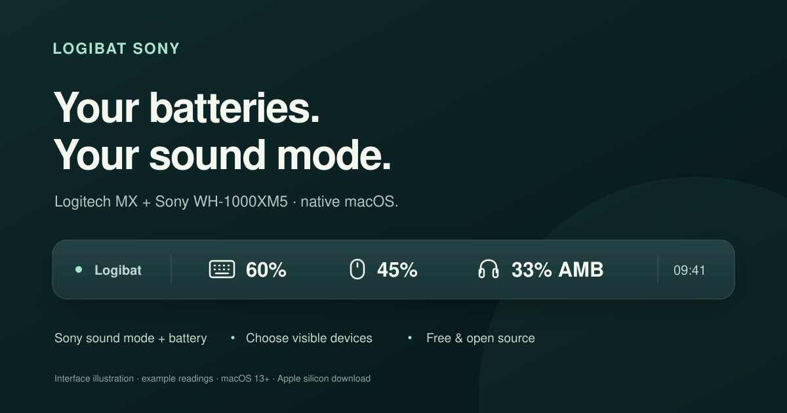

# Logibat Sony — Headphone & Logitech MX Battery Indicator for macOS

**Sony WH-1000XM5 battery and noise-control mode, alongside your Logitech keyboard and mouse.**



Logibat Sony is a free, native Mac menu bar app for **Sony WH-1000XM5 headphones** and **Logitech MX batteries**. See your headphone battery percentage and current **NC / AMB / OFF** sound mode, plus your MX keyboard and mouse percentages — including Logitech devices connected through a **Logi Bolt USB receiver**.

**[Download for Apple silicon Macs](https://github.com/Numixo/Logibat-Sony/releases/latest)** · [Choose visible devices](#choose-what-appears-in-your-menu-bar) · [Tested hardware](#tested-hardware) · [Build from source](#build-from-source)

This is a standalone derivative of **[Numixo/Logibat](https://github.com/Numixo/Logibat)**, retaining its Git history. It adds Sony headphone monitoring and persistent display preferences. The original repository and its releases remain available separately.

## Download and install

Download **Logibat-Sony-1.1.0-macOS-AppleSilicon.zip** from [the latest release](https://github.com/Numixo/Logibat-Sony/releases/latest), unzip it, and move **Logibat.app** into **Applications**.

- **Requires:** macOS 13 Ventura or later and an Apple silicon Mac (M-series chip). The download does not support Intel Macs.
- **Size:** under 100 KB compressed, approximately 272 KB for the app bundle. Sizes vary by build.
- **Cost:** free, with no subscription, in-app purchases, advertising, or account required.
- **Language:** English menus, tooltips, and instructions.
- **Signing:** locally signed, **not notarized by Apple**. macOS may show an unidentified developer warning. Read Apple's [guide to opening apps safely](https://support.apple.com/en-us/102445) before deciding whether to open it.

The installed app is still named **Logibat.app** and uses the original app identity and preferences. **Quit the old Logibat before replacing it.** Use this build instead of running both versions at the same time.

<a id="download"></a>

## What appears in the menu bar

By default, from left to right:

- **Keyboard icon + percentage** — Logitech MX keyboard battery.
- **Mouse icon + percentage** — Logitech MX mouse battery.
- **Headphone icon + percentage + sound mode** — Sony WH-1000XM5 status.

Headphone sound modes are **NC** (noise cancelling), **AMB** (ambient sound), and **OFF** (noise control disabled). Click any icon for the full device names and, in ambient mode, the reported ambient level out of 20. Charging is marked when reported; batteries at 15% or below are highlighted in orange.

This is a **read-only monitor**. It does not change your headphones' noise-control mode, equalizer, volume, or playback, and it does not record audio. Change sound mode using the headphone button or Sony's app; Logibat displays the reported state.

The banner is an **interface illustration with example readings**, not a desktop screenshot.

## Choose what appears in your menu bar

Click any Logibat icon and open **Show in menu bar**. Check or uncheck:

- **Keyboard**.
- **Mouse**.
- **Sony WH-1000XM5**.
- **Headphone battery percentage**.
- **Headphone sound mode (NC / AMB / OFF)**.

Choices persist after restarting the app. The last two options independently control the headphone label; disabling both leaves the headphone icon by itself. Hiding the headphones stops their monitoring and closes the Sony control connection.

If all three devices are hidden, a small **LB** menu bar item keeps the settings accessible so you can turn them back on.

## Tested hardware

Hardware checks on an Apple silicon Mac running **macOS 15.7.9**:

- **Sony WH-1000XM5**, firmware **2.4.1**, connected over Bluetooth: battery **33%** and **Ambient Sound, level 20** were read successfully.
- **Logitech MX Keys S** and **MX Master 3S**, connected through a **Logi Bolt USB receiver**: battery **60%** and **45%** were read successfully after the Sony addition.

These percentages are observed test values, not fixed values or battery-life estimates. NC, Ambient, and Off payload decoding is covered by protocol fixtures; the live Sony hardware check observed Ambient mode.

Only the **WH-1000XM5 Sony v2 control service** is targeted here. Other Sony models are not claimed as supported. Logitech Unifying receivers and direct Bluetooth HID++ interfaces are probed by the inherited code but remain unverified on hardware.

## Refreshes, disconnection, and permissions

Sony notifications update its display as they arrive. Periodic queries refresh headphone state every two minutes. Logitech batteries are also polled every two minutes, with a refresh after the Mac wakes. **Refresh now** requests a new reading.

A dash means the current reading is unavailable. A headphone disconnect clears its battery and sound mode; unanswered readings expire rather than being shown indefinitely. Wake the device and check its connection before refreshing.

### Sony Bluetooth access

Pair and connect the WH-1000XM5 in macOS Bluetooth settings first. If macOS asks for Bluetooth access, allow **Logibat** to communicate with your headphones. If previously denied, enable Logibat under **System Settings → Privacy & Security → Bluetooth**, then reopen the app.

A phone app or another desktop headphone utility may occupy Sony's control channel. If audio works but battery or mode is unavailable, close that control app and refresh Logibat. Monitoring does not require disconnecting your audio connection.

### Logitech access

If macOS denies Logitech device access, select **Configure Logitech access…**. Add Logibat under **System Settings → Privacy & Security → Input Monitoring**, enable it, and quit and reopen the app. The original USB receiver check did not require a new permission grant.

Input Monitoring is a broad macOS permission. This implementation opens Logitech vendor HID interfaces and registers a vendor-report callback; it does not register keyboard or pointer event listeners. Locally signed app updates can require granting permission again.

## Frequently asked questions

### Can I see my WH-1000XM5 noise cancelling status on a Mac?

Yes. Logibat reads the connected WH-1000XM5's Sony control service and shows its reported noise-control mode as NC, AMB, or OFF. The menu spells out the full mode and shows the ambient level when available.

### Does it still show Logitech batteries over a USB dongle?

Yes. The MX Keys S and MX Master 3S have been checked through a Logi Bolt USB receiver after adding Sony monitoring. You do not need to open Logi Options+ to read these battery percentages. You can keep Options+ for other Logitech settings.

### Can I show just my headphones, or just their battery?

Yes. Use **Show in menu bar** to hide the keyboard and mouse, then choose whether the headphone label includes the battery, sound mode, or both. Settings are saved locally.

### Is Logibat Sony a separate app from Logibat?

It is a separate source repository and download, derived from Logibat. The executable still installs as **Logibat.app** and replaces the original build locally. Run one version at a time.

## Build from source

Requires Apple's Xcode Command Line Tools. No package installation or network downloads are needed to build or run the app:

```sh
./build.sh
```

The app uses Swift, AppKit, IOKit, ServiceManagement, and IOBluetooth. The build targets the Mac's current processor architecture; only the published Apple silicon build has been tested. To create the release ZIP and checksum:

```sh
./package.sh
```

Run protocol framing, payload validation, display-label, and persistent preference checks:

```sh
./test.sh
```

Read the connected headphones from Terminal:

```sh
./Logibat.app/Contents/MacOS/Logibat --diagnose-sony
```

Read Logitech batteries:

```sh
./Logibat.app/Contents/MacOS/Logibat --diagnose
```

Terminal and the GUI app can have different macOS permissions. `--sony-trace` and `--trace` are optional troubleshooting flags for the corresponding diagnostic modes. Review trace output before sharing it, since device reports may contain identifiers.

## Privacy, attribution, and license

No network requests, analytics, advertising, automatic update checks, or audio recording. Device communication and saved display preferences stay on your Mac. **Launch at login** optionally uses the built-in macOS service.

- Based on [Numixo/Logibat](https://github.com/Numixo/Logibat), under the MIT license.
- Sony framing is adapted from [sbtfix](https://github.com/htsecurity/sbtfix), with protocol notes verified there against an XM5 on firmware 2.4.1. See [THIRD_PARTY_NOTICES](THIRD_PARTY_NOTICES); the notice is included in the app bundle.
- [Logitech HID++ 2.0 protocol reference](https://lekensteyn.nl/files/logitech/logitech_hidpp_2.0_specification_draft_2012-06-04.pdf) and [Unified Battery format](https://openlogi.org/hidpp/features/x1004-unified-battery).

Independent community project; not affiliated with or endorsed by Sony, Logitech, or Apple. Product names belong to their respective owners.

[MIT license](LICENSE). Free to use, modify, and redistribute.
